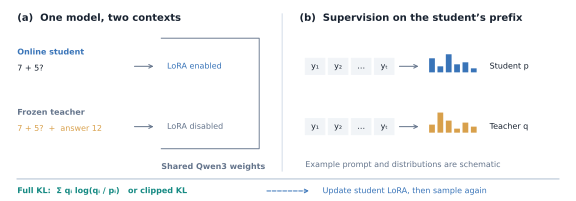

# OPSDMath

**Analyzing KL Clipping in On-Policy Self-Distillation for Budgeted Mathematical Reasoning**

## Overview

How does clipping individual vocabulary terms in on-policy self-distillation affect which problems a language model solves under a fixed token budget? OPSDMath studies this question with Qwen3-1.7B and Qwen3-8B using single-GPU LoRA training, analytical gradient checks, and paired short- and long-budget evaluations.



## Key findings

| Short-budget gain | Early retention | EOS direction audit | Long-budget accuracy |
| --- | --- | --- | --- |
| **+29.69 pp** over clipped OPSD at 128 tokens | **98.57%** with full forward KL | **32/59** frozen 8B reference endings with a local decrease under clipping | **94.79%** with full forward KL at 512 tokens |

Matched Qwen3-8B objective ablation across two training seeds. EOS counts come from the separate gradient audit.

## Method

The student sees the question and samples trajectories before each optimizer update. The teacher receives the reference answer and scores the same sampled prefixes. The objective compares the teacher and student distributions across the full vocabulary at each completion position. The optimizer updates only the student's LoRA parameters. In the matched 8B ablation, both arms use 256 training questions, 64 updates and a 128-token rollout cap. The intervention is a per-vocabulary-term cap of 0.05 in the forward KL objective. [Method](docs/method.md) · [Reference configurations](configs)


For teacher probabilities $q$ and student probabilities $p$, one forward KL contribution is $q_i\log(q_i/p_i)$. Capping individual contributions removes the derivative of the capped terms, while softmax normalization still couples the student logits. The analytic derivatives were checked against autograd. The contribution plots illustrate the objective. The EOS panel uses measured audit counts.

At temperature 1.1, clipping would locally lower EOS log-probability on 32 of 59 reference endings for frozen Qwen3-8B and 2 of 59 for frozen Qwen3-1.7B. Full forward KL had zero decreases across the six audited checkpoints. The local logit derivative leaves the effect on generation after training unresolved. [Per-checkpoint audit](docs/experiments.md#cross-scale-eos-audit)

## Experimental results

At 128 tokens the question-paired 95% confidence interval was [23.70, 35.68] percentage points for full KL versus clipped OPSD and [4.43, 13.28] for full KL versus the frozen base.

| Method | Acc@128 | Acc@512 | Early retention | Late acceleration |
| --- | ---: | ---: | ---: | ---: |
| Frozen Qwen3-8B | 72.92% | 94.27% | 100.00% | 0.00% |
| Clipped OPSD | 51.82% | 94.27% | 70.36% | 2.44% |
| **Full forward KL** | **81.51%** | **94.79%** | **98.57%** | 42.68% |
| Equation-chain SFT | 72.14% | 73.70% | 79.64% | **58.54%** |

Accuracy is averaged across seeds 17 and 29 on the same **192 project-held-out questions from the GSM8K training partition**. Both budgets are scored on the same trajectory. Early retention is measured on the 140 questions the base answers by 128 tokens. Late acceleration uses the 41 questions the base answers only at 512 tokens. Full KL gains 8.59 points over the base at 128 tokens, and the paired interval against the base at 512 tokens includes zero. [Per-seed counts and protocol](docs/experiments.md) · [Paired statistics](results/kl_ablation/paired-two-seed.json)


On **SVAMP**, the frozen base and both full-KL runs scored **236/256 at 128 tokens**. The two runs retained **233/236** and **234/236** of the base's early answers. At 512 tokens they scored **237/256** and **238/256**, versus **238/256** for the base. The base had only two late questions under this protocol, so this transfer check primarily informs retention. [SVAMP replay and retention counts](results/transfer_evaluation/summary.json)

## Quick start

From a checkout, use Python 3.12 or later.

```bash
python -m pip install -e .
opsdmath-reproduce --experiment kl-ablation
```

CPU replay verifies the saved archive hashes and recomputes the GSM8K paired results, SVAMP scores and retention, and EOS direction counts. CUDA training and inference use the pinned model revision, data split, and [configurations](configs). The guide covers training the adapters locally and verifying any original copies available to you. [Reproduction guide](docs/reproduction.md)

## Repository structure

| Directory | Contents |
| --- | --- |
| [opsdmath](opsdmath) | Objectives, single-GPU training, inference, and paired statistics |
| [configs](configs) | Matched training recipes and reference evaluation protocol |
| [experiments](experiments) and [results](results) | KL ablation, gradient audit, SVAMP transfer, and Trainer validation |
| [scripts](scripts) and [assets](assets) | Data preparation, reproduction, and figures |
| [archive](archive) | Earlier budget, teacher-context, and retention studies with their original evidence |

## Key implementations

| Component | Source |
| --- | --- |
| Single-GPU on-policy training loop | [trainer.py](opsdmath/training/trainer.py) |
| Clipped and full forward KL | [kl.py](opsdmath/objectives/kl.py) |
| Analytic logit gradients | [gradients.py](opsdmath/analysis/gradients.py) |
| Student rollouts and frozen teacher scoring | [rollout.py](opsdmath/training/rollout.py) |
| Paired statistical evaluation | [paired_statistics.py](opsdmath/analysis/paired_statistics.py) |

## Supplementary studies

The fixed-update audit matched gradients and updates across **392 LoRA parameter tensors** after matching the loss arithmetic and forward inputs. In a separate upstream Trainer audit, interrupting at update four of eight reproduced all **32 prompt and rollout hashes** and the compared adapter tensors. Earlier studies cover structured answers, matched budget pressure across scales, teacher context, and retention routing. [Trainer validation](docs/trainer_parity.md) · [Supplementary studies](docs/supplementary.md)

## References

The training setup follows [Self-Distilled Reasoner](https://proceedings.mlr.press/v306/zhao26be.html). Related work examines [correction reversal under pointwise KL clipping](https://arxiv.org/abs/2609.38995) and [termination behavior in OPSD](https://arxiv.org/abs/2611.19925). The experiments use [Qwen3](https://huggingface.co/Qwen/Qwen3-8B), [GSM8K](https://github.com/openai/grade-school-math), and [SVAMP](https://aclanthology.org/2021.naacl-main.168/).
