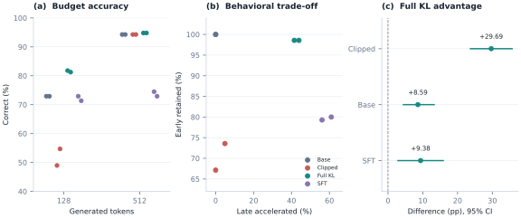

# OPSDMath

**Gradient Analysis and Budget-Efficient On-Policy Self-Distillation**

How does on-policy self-distillation change which math problems a model can solve within a fixed token budget? OPSDMath studies this question with Qwen3-1.7B and Qwen3-8B. It combines single-GPU LoRA training, a logit-level analysis of vocabulary-wise KL clipping, and paired evaluations that track which answers arrive earlier and which previously correct answers are lost.

## Research highlights

- **Single-GPU on-policy distillation.** The student generates fresh trajectories during training. The frozen teacher reuses the Qwen3 weights with the student adapter disabled. Completion-only logits limit the output positions carried through the training computation.
- **Gradient diagnostics across model scales.** The project derives the clipped and unclipped logit gradients, verifies the analytic result with autograd, and audits their local effect on end-of-sequence probability on shared reference endings.
- **Accuracy under a short generation budget.** A matched 8B objective ablation measures short-budget accuracy, preservation of early correct answers, and the number of problems answered earlier than by the frozen base.

## On-policy training architecture


The student sees the question and samples trajectories before each optimizer update. The teacher receives the reference answer and scores the same sampled prefixes. The objective compares the teacher and student distributions across the full vocabulary at each completion position. The optimizer updates only the student's LoRA parameters. In the matched 8B ablation, both arms use 256 training questions, 64 updates and a 128-token rollout cap. The intervention is a per-vocabulary-term cap of 0.05 in the forward KL objective. [Method](docs/method.md) · [Trainer](opsdmath/training/trainer.py) · [Reference configurations](configs)

## Gradient mechanism


For teacher probabilities $q$ and student probabilities $p$, one forward KL contribution is $q_i\log(q_i/p_i)$. Capping individual contributions removes the derivative of the capped terms, while softmax normalization still couples the student logits. The analytic derivatives were checked against autograd. The contribution plots illustrate the objective. The EOS panel uses measured audit counts.

In the reference-ending audit at temperature 1.1, a local logit descent step under clipped KL would **decrease EOS log-probability** in the following cases.

| Checkpoint | Qwen3-1.7B | Qwen3-8B |
| --- | ---: | ---: |
| Frozen base | 2/59 | 32/59 |
| Adapter, seed 17 | 2/59 | 26/59 |
| Adapter, seed 29 | 1/59 | 22/59 |

Full forward KL had zero such decreases in each group. The audit measures a local change in EOS log-probability in logit space. Its contribution to generation after model parameter updates remains open. [Analytic gradients](opsdmath/analysis/gradients.py) · [EOS audit data](results/scale-transfer/privileged-gradient-audit/eos-paired.json)

## Main results

Full forward KL averaged **81.51% at 128 tokens** and **94.79% at 512 tokens** across seeds 17 and 29. At 128 tokens it improved accuracy by **29.69 percentage points** over clipped OPSD (question-paired 95% CI [23.70, 35.68]) and by **8.59 percentage points** over frozen Qwen3-8B (95% CI [4.43, 13.28]). It retained **98.57%** of the frozen model's early correct answers in each run.

| Method | 128-token correct / 192 | Early retained / 140 | Late accelerated / 41 | 512-token correct / 192 |
| --- | ---: | ---: | ---: | ---: |
| Frozen Qwen3-8B | 140 | 140 | 0 | 181 |
| Clipped OPSD | 94 / 105 | 94 / 103 | 0 / 2 | 181 / 181 |
| **Full forward KL** | **157 / 156** | **138 / 138** | 18 / 17 | **182 / 182** |
| Equation-chain SFT | 140 / 137 | 112 / 111 | **25 / 23** | 143 / 140 |

All methods use the same **192 project-held-out questions from the GSM8K training partition**, with both budgets scored on the same trajectory. Slashes separate seeds 17 and 29. Early retention counts questions the base solves by 128 tokens. Late acceleration counts questions the base solves only at 512 tokens that the adapted model answers by 128. Equation-chain SFT accelerated more late answers. Full KL retained more early answers, and its paired difference from the base at 512 tokens includes zero. [Experiment protocol](docs/experiments.md) · [Paired statistics](results/scale-transfer/privileged-gradient-audit/kl-pilot/paired-two-seed.json)



On **SVAMP**, the frozen base and both full-KL runs scored **236/256 at 128 tokens**. The two runs retained **233/236** and **234/236** of the base's early answers. At 512 tokens they scored **237/256** and **238/256**, versus **238/256** for the base. The base had only two late questions under this protocol, so this transfer check primarily informs retention. [SVAMP paired statistics](results/scale-transfer/privileged-gradient-audit/kl-pilot/paired-two-seed.json)

## Training verification

- **Trainer parity.** One fixed Qwen3-1.7B AdamW update used four identical unpadded cached trajectories, identical starting weights and gradient clipping, and matched FP32 loss arithmetic, forward inputs, and completion-only logits. The maximum loss discrepancy from the pinned upstream Trainer was **9.32 × 10⁻¹⁰**. Gradients and resulting updates matched exactly across **392 LoRA parameter tensors**.
- **Interrupted-run recovery.** In a separate deterministic upstream Trainer run with Transformers generation, resuming at update four of eight reproduced all **32 prompt and rollout hashes** and all **392 LoRA tensors** at the compared checkpoints. [Parity and recovery protocol](docs/trainer_parity.md)

## Additional experiments

Earlier studies compared Qwen3-1.7B budget curves and shared grammar-constrained answer fields, varied teacher context and answer reserves under controlled changes to math questions, and reevaluated the two model scales under matched budget pressure. Retention experiments verified a token-identical no-op anchor against the frozen model. Behavior-based assignment had no established advantage over matched random routing in those runs. [Budget study](results/budget-study) · [Teacher-context and answer-format studies](results/condition-study) · [Cross-scale reevaluation](results/scale-transfer/crossed-budget-study) · [Retention experiments](results/scale-transfer/retention-study)

## Installation and quick start

Use Python 3.12 from a checkout of this repository.

```bash
python -m pip install -e .
opsdmath-reproduce --experiment kl-ablation
```

This CPU command verifies the prediction archive hashes and recomputes the full paired GSM8K and SVAMP report.

## Reproduction

With CUDA-enabled PyTorch, install `.[training]` for config-driven training and inference. `opsdmath-train` takes a selected recipe and seed, a local model, and the prepared training split. `opsdmath-evaluate` scores the locked short and long budgets for named checkpoints. The guide records the model revision, dataset preparation, adapter checksums and exact commands. [Reproduction guide](docs/reproduction.md) · [Archived predictions and configurations](results/scale-transfer/privileged-gradient-audit/kl-pilot)

## References

The training setup follows [Self-Distilled Reasoner](https://proceedings.mlr.press/v306/zhao26be.html). Related work examines [correction reversal under pointwise KL clipping](https://arxiv.org/abs/2609.38995) and [termination behavior in OPSD](https://arxiv.org/abs/2611.19925). The experiments use [Qwen3](https://huggingface.co/Qwen/Qwen3-8B), [GSM8K](https://github.com/openai/grade-school-math), and [SVAMP](https://aclanthology.org/2021.naacl-main.168/).
