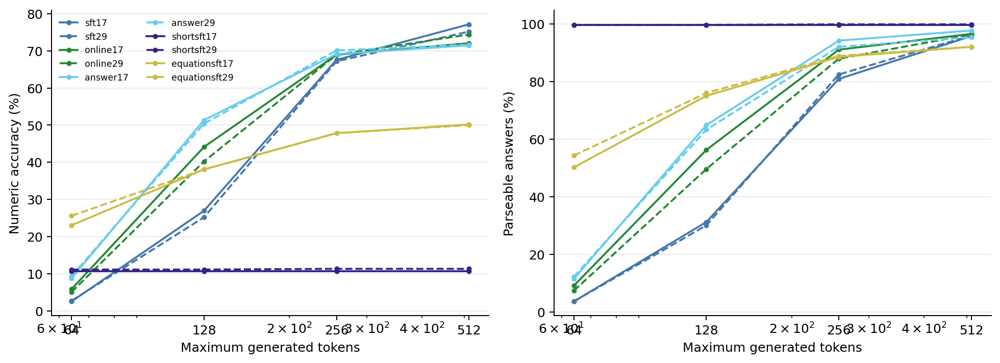
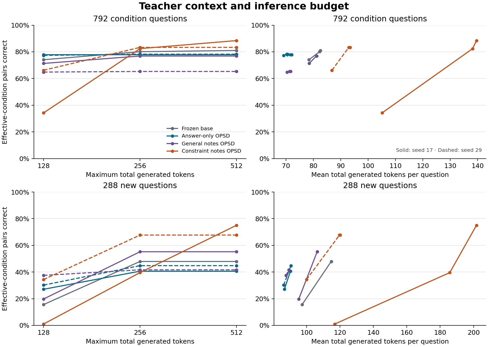

# OPSDMath

A reproducible study of short-budget math answers with Qwen3-1.7B. It compares on-policy self-distillation (OPSD) and supervised fine-tuning (SFT) at the same generation cap, and measures when each model gives a correct number in a usable format.

## Results

At **128 generated tokens**, an OPSD teacher that sees only the final training answer outperforms SFT on compact equation chains under numeric extraction. Numbers are correct answers per evaluation split.

| Dataset | Answer-only teacher OPSD, seeds 17 / 29 | Equation-chain SFT, seeds 17 / 29 |
| --- | ---: | ---: |
| GSM8K confirmation | 263/512 · 258/512 | 195/512 · 195/512 |
| SVAMP sample | 212/256 · 206/256 | 138/256 · 131/256 |

GSM8K improvements of **13.28 and 12.30 percentage points** come despite equation-chain SFT generating shorter answers and producing more extractable answers. SFT follows the exact answer-line format much more often. At 512 tokens, full-solution SFT scores 395/512 and 385/512, ahead of answer-only OPSD at 366/512 and 367/512. Training uses one base model, 256 GSM8K questions, two seeds, and 64 updates per group.

[Experimental report](后续实验报告.md) · [GSM8K metrics](results/budget-study/confirmation-metrics.csv) · [SVAMP metrics](results/budget-study/svamp-metrics.csv) · [Paired differences](results/budget-study/answer-delivery-paired.csv)



## Reproduce the comparison

Use a Linux CUDA environment with Python 3.11 or 3.12 and CUDA-enabled PyTorch 2.8.

```bash
python -m pip install transformers==4.57.1 peft==0.17.1 accelerate==1.11.0 safetensors==0.5.3
python gsm8k.py prepare data
python budget_study.py prepare data data/next-confirmation
hf download Qwen/Qwen3-1.7B --revision 70d244cc86ccca08cf5af4e1e306ecf908b1ad5e --local-dir model
python short_sft_baseline.py prepare data/train.jsonl data/equation-sft --target equations

for seed in 17 29; do
    python run_math.py opsd --model model --data data/train.jsonl --seed "$seed" \
        --teacher-context answer --output "runs/train/answer$seed"
    python run_math.py sft --model model --data data/equation-sft/train.jsonl --seed "$seed" \
        --output "runs/train/equationsft$seed"
done

for name in answer17 equationsft17 answer29 equationsft29; do
    python run_math.py predict --model model --data data/next-confirmation/inputs.jsonl \
        --adapter "runs/train/$name/adapter" --cap 512 --batch-size 16 --save-token-ids \
        --output "runs/predict/$name"
done
python budget_study.py report model data/next-confirmation/labels.jsonl runs/score \
    answer17=runs/predict/answer17/base.jsonl equationsft17=runs/predict/equationsft17/base.jsonl \
    answer29=runs/predict/answer29/base.jsonl equationsft29=runs/predict/equationsft29/base.jsonl
```

The scorer decodes the 64-, 128-, 256- and 512-token prefixes under three extraction policies. For SVAMP, run `python prepare_svamp.py data/train.jsonl data/svamp`, generate from `data/svamp/inputs.jsonl` at `--cap 128`, and use `budget_study.py report` with the SVAMP labels and `--budgets 128`.

### Shared numeric output field

A follow-up uses one output contract for both models. Each model can draft up to 104 tokens, then fills the same grammar-constrained numeric field. The draft, delimiter and final field together fit within 128 tokens. Unfinished fields count as wrong.

| Dataset | Answer-only teacher OPSD, seeds 17 / 29 | Equation-chain SFT, seeds 17 / 29 |
| --- | ---: | ---: |
| GSM8K confirmation | 259/512 · 248/512 | 196/512 · 198/512 |
| SVAMP sample | 207/256 · 202/256 | 144/256 · 138/256 |

OPSD retains a numeric-accuracy advantage under this contract. Equation-chain SFT still uses fewer tokens and completes more fields on GSM8K. The follow-up reuses the evaluated questions.

```bash
for name in answer17 equationsft17 answer29 equationsft29; do
    python structured_answer_budget.py --model model --data data/next-confirmation/inputs.jsonl         --adapter "runs/train/$name/adapter" --output "runs/structured/$name"
done
python score_structured_answer.py data/next-confirmation/labels.jsonl runs/structured runs/structured-score
```

[Structured GSM8K metrics](results/budget-study/structured-gsm8k-metrics.csv) · [Structured SVAMP metrics](results/budget-study/structured-svamp-metrics.csv)

## Condition changes and teacher notes

The controlled evaluation contains 216 base problems and 792 question variants. It changes relevant conditions, adds irrelevant information, and tests changes in numerical values and quantifier scope. Results below use the shared 128-token answer protocol. A pair counts as correct when both questions are answered correctly.

| Training method | Effective-condition pairs correct | Irrelevant-condition pairs correct |
| --- | ---: | ---: |
| Frozen Qwen3-1.7B | 160/216 | 187/216 |
| Equation-chain SFT, two seeds | 121/216 · 119/216 | 116/216 · 114/216 |
| Answer-only teacher OPSD | 168/216 · 167/216 | 187/216 · 187/216 |
| General teacher notes | 154/216 · 140/216 | 181/216 · 152/216 |
| Constraint-focused teacher notes | 74/216 · 143/216 | 126/216 · 188/216 |

Answer-only OPSD outperforms equation-chain SFT on this test. Its gain relative to the frozen base is smaller, and the paired intervals include zero for both seeds. The two note policies use the same structured format and matched lengths. A frozen model generates the notes from the questions. Their students show lower effective-condition pair accuracy than the corresponding answer-only models at 128 tokens. One constraint-trained student reaches its draft cap on all 72 quantifier-scope variants.

At 512 tokens the two constraint-trained students recover to **191/216** and **180/216** effective-condition pairs, with mean outputs of **139.5** and **93.4** tokens per question. The frozen model reaches 175/216 at 82.6 tokens. On 288 additional questions, the constraint-trained students also improve as the budget grows, while the relative ranking at 128 tokens varies by seed. The results characterize how teacher context changes answer delivery under a shared budget.



[Condition-change metrics](results/condition-study/metrics.json) · [Experiment and reproduction](条件干预实验报告.md)

### Answer allocation and trainer checks

With total generation capped at 128 tokens, varying the answer reserve changes how much space the model has for its draft. For the weakest constraint checkpoint, the number of valid answer fields rises from **144/288** to **205/288** as the reserve grows from 16 to 48 tokens. Its effective-condition pair accuracy stays at **1/96** throughout. Another constraint checkpoint drops from **33/96** at a reserve of 24 to **16/96** at a reserve of 48.

On four cached student trajectories, the native clipped objective and the pinned upstream objective agree to within **9.32×10⁻¹⁰**, with identical LoRA gradients. A separate test runs the upstream Trainer with Transformers generation and resumes after the first update. In deterministic mode, the resumed and uninterrupted runs produce identical rollouts and adapter tensors at both steps.

[Answer allocation and Trainer results](results/condition-study/engineering-controls.json) · [Fixed-update and recovery checks](TRAINER_PARITY.md) · [Replication details](条件干预实验报告.md)

### External transfer to MATH-500

Under a shared boxed-answer prompt, answer-only OPSD scores **34/500 and 28/500** at 128 generated tokens, compared with **18/500** for frozen Qwen3-1.7B, **28/500 and 22/500** for full-solution OPSD, and **7/500** for each full-solution SFT seed. At 512 tokens, answer-only OPSD scores **263/500 and 262/500** against **253/500** for the frozen model. Both 512-token paired intervals against frozen include zero. The adapters were trained on GSM8K.

[MATH-500 results and provenance](results/condition-study/engineering-followup.json)

## References

The training objective follows [Self-Distilled Reasoner](https://proceedings.mlr.press/v306/zhao26be.html). This repo adapts the training loop to one GPU and provides the training targets, evaluation, and comparisons. Data comes from [GSM8K](https://github.com/openai/grade-school-math) and [SVAMP](https://aclanthology.org/2021.naacl-main.168/). The [initial reproduction](实验报告.md) records earlier runs on a separate 256-question evaluation set.

The note comparison adapts the question-only brief generation studied in [B-OPSD](https://arxiv.org/abs/2611.19273). The template interventions follow the experimental approach of [GSM-Symbolic](https://arxiv.org/abs/2410.05229).
