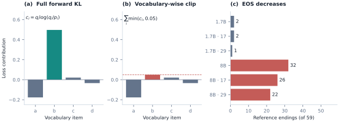

# OPSDMath

**Analyzing KL Clipping in On-Policy Self-Distillation for Budgeted Mathematical Reasoning**

## Overview

How does clipping individual vocabulary terms in on-policy self-distillation affect which problems a language model solves under a fixed token budget? OPSDMath studies this question with Qwen3-1.7B and Qwen3-8B using single-GPU LoRA training, analytical gradient checks, and paired short- and long-budget evaluations.


## Key findings

- **Short-budget accuracy.** Full forward KL reached **81.51% at 128 tokens** on 192 project-held-out GSM8K questions across two 8B training seeds. This is **+29.69 percentage points** over clipped OPSD and **+8.59** over the frozen model.
- **Retention.** Both full-KL runs retained **138 of 140 (98.57%)** early correct answers. Mean accuracy reached **94.79% at 512 tokens**, and the paired interval for the gain at that budget includes zero.
- **Local EOS gradient.** Clipping would lower EOS log-probability on **32/59** reference endings for frozen 8B and **2/59** for frozen 1.7B. The audit measures a local change in logit space. The link to generation after training remains open.

## Method

The student sees the question and samples trajectories before each optimizer update. The teacher receives the reference answer and scores the same sampled prefixes. The objective compares the teacher and student distributions across the full vocabulary at each completion position. The optimizer updates only the student's LoRA parameters. In the matched 8B ablation, both arms use 256 training questions, 64 updates and a 128-token rollout cap. The intervention is a per-vocabulary-term cap of 0.05 in the forward KL objective. [Method](docs/method.md) · [Trainer](opsdmath/training/trainer.py) · [Reference configurations](configs)



For teacher probabilities $q$ and student probabilities $p$, one forward KL contribution is $q_i\log(q_i/p_i)$. Capping individual contributions removes the derivative of the capped terms, while softmax normalization still couples the student logits. The analytic derivatives were checked against autograd. The contribution plots illustrate the objective. The EOS panel uses measured audit counts.

In the reference-ending audit at temperature 1.1, a local logit descent step under clipped KL would **decrease EOS log-probability** in the following cases.

| Checkpoint | Qwen3-1.7B | Qwen3-8B |
| --- | ---: | ---: |
| Frozen base | 2/59 | 32/59 |
| Adapter, seed 17 | 2/59 | 26/59 |
| Adapter, seed 29 | 1/59 | 22/59 |

Full forward KL had zero such decreases in each group. The audit measures a local change in EOS log-probability in logit space. Its contribution to generation after model parameter updates remains open. [Analytic gradients](opsdmath/analysis/gradients.py) · [EOS audit data](results/gradient_audit/eos-paired.json)

## Experimental results

At 128 tokens the question-paired 95% confidence interval was [23.70, 35.68] percentage points for full KL versus clipped OPSD and [4.43, 13.28] for full KL versus the frozen base.

| Method | 128-token correct / 192 | Early retained / 140 | Late accelerated / 41 | 512-token correct / 192 |
| --- | ---: | ---: | ---: | ---: |
| Frozen Qwen3-8B | 140 | 140 | 0 | 181 |
| Clipped OPSD | 94 / 105 | 94 / 103 | 0 / 2 | 181 / 181 |
| **Full forward KL** | **157 / 156** | **138 / 138** | 18 / 17 | **182 / 182** |
| Equation-chain SFT | 140 / 137 | 112 / 111 | **25 / 23** | 143 / 140 |

All methods use the same **192 project-held-out questions from the GSM8K training partition**, with both budgets scored on the same trajectory. Slashes separate seeds 17 and 29. Early retention counts questions the base solves by 128 tokens. Late acceleration counts questions the base solves only at 512 tokens that the adapted model answers by 128. Equation-chain SFT accelerated more late answers. Full KL retained more early answers, and its paired difference from the base at 512 tokens includes zero. [Experiment protocol](docs/experiments.md) · [Paired statistics](results/kl_ablation/paired-two-seed.json)


On **SVAMP**, the frozen base and both full-KL runs scored **236/256 at 128 tokens**. The two runs retained **233/236** and **234/236** of the base's early answers. At 512 tokens they scored **237/256** and **238/256**, versus **238/256** for the base. The base had only two late questions under this protocol, so this transfer check primarily informs retention. [SVAMP replay and retention counts](results/transfer_evaluation/summary.json)

## Quick start

From a checkout, use Python 3.12 or later.

```bash
python -m pip install -e .
opsdmath-reproduce --experiment kl-ablation
```

CPU replay verifies the saved archive hashes and recomputes the GSM8K paired results, SVAMP scores and retention, and EOS direction counts. CUDA training and inference use the pinned model revision, data split, and [configurations](configs). The guide covers training the adapters locally and verifying any original copies available to you. [Reproduction guide](docs/reproduction.md)

## Repository structure

| Directory | Contents |
| --- | --- |
| [opsdmath](opsdmath) | Objectives, single-GPU training, inference, and paired statistics |
| [configs](configs) | Matched training recipes and reference evaluation protocol |
| [experiments](experiments) and [results](results) | KL ablation, gradient audit, SVAMP transfer, and Trainer validation |
| [scripts](scripts) and [assets](assets) | Data preparation, reproduction, and figures |
| [archive](archive) | Earlier budget, teacher-context, and retention studies with their original evidence |

## Supplementary studies

The fixed-update audit matched gradients and updates across **392 LoRA parameter tensors** after matching the loss arithmetic and forward inputs. In a separate upstream Trainer audit, interrupting at update four of eight reproduced all **32 prompt and rollout hashes** and the compared adapter tensors. Earlier studies cover structured answers, matched budget pressure across scales, teacher context, and retention routing. [Trainer validation](docs/trainer_parity.md) · [Supplementary studies](docs/supplementary.md)

## References

The training setup follows [Self-Distilled Reasoner](https://proceedings.mlr.press/v306/zhao26be.html). Related work examines [correction reversal under pointwise KL clipping](https://arxiv.org/abs/2609.38995) and [termination behavior in OPSD](https://arxiv.org/abs/2611.19925). The experiments use [Qwen3](https://huggingface.co/Qwen/Qwen3-8B), [GSM8K](https://github.com/openai/grade-school-math), and [SVAMP](https://aclanthology.org/2021.naacl-main.168/).
