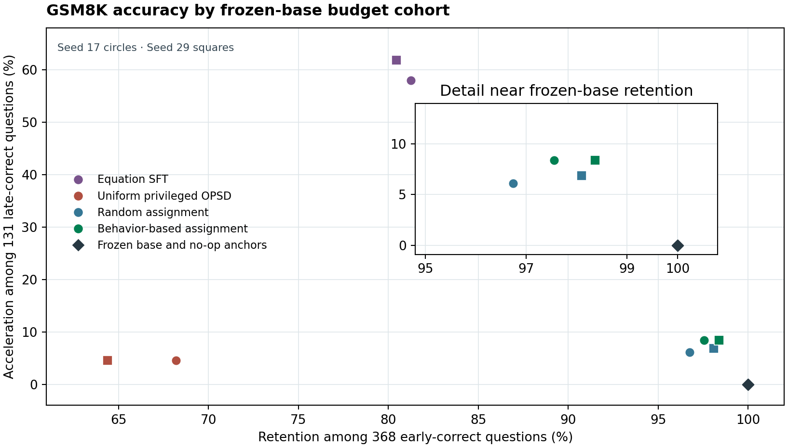

# OPSDMath 保留感知的选择性在线自蒸馏

实验检验一个可测的假设。按冻结底座在短、长两个预算下的表现分配教师监督，能否在保留原有短预算正确题的同时，增加提前答对的题。

**训练正确性与两种子稳定性通过验收。按底座行为分组优于全特权蒸馏，但相对于等比例随机分组的额外收益未建立，独立 SVAMP 也没有给出支持。** 修正版保留了原先短预算正确的多数题，同时让每个种子各 11 道原本晚答的 GSM8K 题提前答对。总体正确率比冻结底座只多 3 道和 6 道。

## 历史结果与研究问题

在已经用于诊断的 512 道 GSM8K 上，固定原提示，冻结 Qwen3-8B 有 319 道题在 128 tokens 内答对，149 道到 512 tokens 才答对，44 道在两个截点均未答对。按历史的宽松数值解析复算后，两种子并未支持统一的 Answer-only OPSD 优势。

| 历史方法 | 原有短预算正确题保留 | 长预算才答对的题提前答对 | 两个预算均未答对的题新增正确 | 128/512 tokens 正确题数 |
| --- | ---: | ---: | ---: | ---: |
| 冻结底座 | 319/319 | 0/149 | 0/44 | 319/468 |
| Answer-only OPSD 17 | 306/319 | 52/149 | 3/44 | 361/465 |
| Answer-only OPSD 29 | 278/319 | 9/149 | 0/44 | 287/466 |
| Equation SFT 17 | 257/319 | 62/149 | 4/44 | 323/343 |
| Equation SFT 29 | 247/319 | 60/149 | 2/44 | 309/327 |

种子 17 的 OPSD 相对同种子算式 SFT 多对 38 题，其中保留项多 49 题，提前项少 10 题，其他项少 1 题。种子 29 的 OPSD 也保留更多原本答对的题，但更少提前答对，最终低于算式 SFT。提前答对指标衡量指定前缀里能否解析到正确答案，包含格式和完成时机的影响。 [原规模对照](8B规模对照报告.md) · [历史逐题分层复算](results/scale-transfer/retention-study/historical-cohorts.json)

## 恢复后的开发校准

中断时云端 RTX 5090 作业仍在运行。回收的日志显示，四组各完成 64 次更新。这里使用同一批 64 道开发题及种子 17。显式预算提示同时包含 128-token 限制与优先保留关键步骤的要求。该阶段的训练采样上限为 256 tokens。

| 教师与逐项裁剪 | 原提示正确 | 显式预算提示正确 | 实际采样 tokens |
| --- | ---: | ---: | ---: |
| 冻结底座 | 48/64 | 48/64 | — |
| Answer-only，thinking off，0.05 | 52/64 | 51/64 | 28,518 |
| Answer-only，thinking off，0.001 | 44/64 | 51/64 | 30,903 |
| Answer-only，thinking off，1e-7 | 48/64 | 49/64 | 31,293 |
| Answer-only，thinking on，0.05 | 51/64 | 49/64 | 28,417 |

在固定学生轨迹上，thinking-off Answer-only 教师的 0.001 与 1e-7 裁剪相对原 0.05 的 logit 梯度方向余弦中位数都约为 0.836，确认裁剪确实改变监督信号。开发结果未显示更小阈值或 Thinking Teacher 在两种提示上都有收益。主比较采用 0.05 并统一关闭 thinking，以维持原配方和同模式教师对照。 [校准代码](opsd_calibration.py) · [校准工件](results/scale-transfer/retention-study/calibration-evidence.tar.gz)

回收的提示因子对照把数值预算和「优先保留关键步骤」拆开。下表为旧模型在同一 64 题上的自由生成结果。仅增加预算比原提示对五个模型都有提升。加上关键步骤以后，旧 Answer-only OPSD 两个种子相对仅预算少对 5、6 题，算式 SFT 两个种子分别多对 2、少对 2 题。主试验将预算加关键步骤固定为所有组共同的训练及评测提示，沿用既有 8B 对照协议。 [提示因子逐题工件](results/scale-transfer/retention-study/calibration-evidence.tar.gz)

| 历史检查点 | 原提示 | 仅预算 | 仅关键步骤 | 两条都加 |
| --- | ---: | ---: | ---: | ---: |
| 冻结底座 | 48 | 53 | 42 | 49 |
| Answer-only OPSD 17 | 53 | 57 | 46 | 52 |
| Answer-only OPSD 29 | 45 | 51 | 39 | 45 |
| Equation SFT 17 | 47 | 53 | 49 | 55 |
| Equation SFT 29 | 41 | 56 | 50 | 54 |

## 前瞻对照

固定 Qwen3-8B BF16、原 256 道训练题、64 次更新、累积 4 条、LoRA rank 64、初始学习率 5×10⁻⁶ 和种子 17、29。所有学生和教师使用同一条 128-token 预算提示并关闭 thinking。在线学生采样上限为 128，教师沿当前学生采样的后缀计算逐 token 的冻结分布。保留现有 0.05 逐词表项裁剪的前向 KL。

仅在训练集上，先用冻结底座生成最多 512 tokens，分别评分 128 和 512 两个截点。128 已正确为早答组，只有 512 正确为晚答组，两个截点均未正确为双错组。行为路由仅在晚答组给教师金标准答案，早答和双错组给教师同一无特权问题。随机组精准匹配特权样本数量，其余同配置。

| 组别 | 教师或目标 |
| --- | --- |
| A 冻结底座 | 相同显式预算提示 |
| B Equation SFT | 算式链及金标准答案 |
| C 统一特权 OPSD | 每题教师都看最终答案 |
| D 无特权 OPSD | 每题教师只看问题 |
| E 等比例随机 OPSD | 随机选择与行为组同量的问题给最终答案 |
| F 行为路由 OPSD | 仅对冻结底座晚答的训练题给最终答案 |

冻结确认集为剔除两个已用测试拆分和训练来源重叠后的 551 道 GSM8K。按文件验证输入哈希，先完成训练，再评估确认集。测试端用同一条 128-token 提示，统一生成到 EOS 或 512 上限，再评分 128 和 512 的前缀。因此长截点衡量给定相同提示时额外生成空间内的答对情况。对每个模型在首批比较直接生成 128 tokens 与前缀结果。主比较为 F 对 C、E 在短预算总体、原有早答题保留和晚答题提前上的配对差，两种子分别报告，均值的自助法在同一题上联合抽样。另报两个数值解析口径和严格格式、长预算准确率、实际生成长度与在线采样开销。 [数据清单](results/scale-transfer/retention-study/data-manifest.json) · [执行脚本](launch_retention_study.sh) · [分层评分器](retention_study.py)

## 首轮结果与锚定问题

训练分层为 178 道早答、60 道晚答、18 道双错。GSM8K 确认集相应为 368、131、52 道。首轮在所有教师分支都用 0.05 逐词表项裁剪。两种子都完成训练及同一批 551 题评测。

| 首轮方法 | 种子 | 128 正确 | 早答保留 | 晚答提前 | 512 正确 |
| --- | ---: | ---: | ---: | ---: | ---: |
| 冻结底座 | — | 368 | 368 | 0 | 499 |
| Equation SFT | 17 | 383 | 299 | 76 | 395 |
| Equation SFT | 29 | 386 | 296 | 81 | 400 |
| 统一特权 | 17 | 260 | 251 | 6 | 504 |
| 统一特权 | 29 | 248 | 237 | 6 | 506 |
| 无特权 | 17 | 462 | 356 | 92 | 491 |
| 无特权 | 29 | 84 | 84 | 0 | 512 |
| 等比例随机 | 17 | 463 | 357 | 95 | 491 |
| 等比例随机 | 29 | 107 | 107 | 0 | 514 |
| 行为路由 | 17 | 467 | 356 | 98 | 489 |
| 行为路由 | 29 | 133 | 131 | 0 | 509 |

无特权对照揭示了两个问题。第一，无特权教师和学生在初始步的 logits 相同、损失为零，FP32 反传仍给出约 2.7×10⁻⁷ 与 5.5×10⁻⁷ 的 adapter 梯度范数。Adam 将舍入残差转成非零更新。修复后同一张卡四题试跑的四次前向均核验 logits 完全相同，该步梯度范数为 0。第二，对带符号的逐词表项只做上裁剪，求和可能小于零。首轮行为路由的最后 32 个无特权样本中，未裁剪 KL 中位数为 0.276 与 0.271，裁剪目标中位数却为 −0.0090 与 −0.0108。因此，首轮的无特权分支不能作为有效的冻结策略锚定。上表保留为机制诊断。 [首轮指标与配对区间](results/scale-transfer/retention-study/initial-results.json)

修正版本在 logits 完全相同时返回精确零梯度，并对所有无特权分支采用完整前向 KL。特权分支及采样协议继续沿用 0.05 逐项裁剪。重新训练 D、E、F 的两个种子。A 与 B 不依赖这两个改动。C 两组的首轮训练日志中未裁剪 KL 在所有样本均为正，精确相等分支不会触发，因此复用两组训练及原 GSM8K 预测。修正后的 GSM8K 是在已读结果上的复评。另固定 SVAMP 上此前未纳入评测的 256 道，复用已有源码版本，排除此前按相同规则排序的前 256 道，作为修正方案的独立题源确认。 [SVAMP 冻结清单](results/scale-transfer/retention-study/svamp-manifest.json)

随机组也须独立审计训练顺序。初版用同一个整数种子从排序后的 ID 抽样和打乱数据。复算发现，两个种子的 60 道特权题全部在各自训练顺序的第 197–256 位，和学习率线性衰减混杂。最终比较使用独立命名的随机流重新生成等量分配，保留训练抽样次序并记录每道特权题所在的位置。首轮表中的随机结果只作为故障记录。无特权组和行为路由的分配均不依赖该随机流。

## 训练正确性与随机状态验收

两个种子的纯无特权组各有 256/256 个样本的教师与学生 logits 完全相同，64/64 次更新的梯度范数为 0。在 551 道 GSM8K 和 256 道 SVAMP 上，两组的完整生成 token 序列逐题等于冻结底座。种子 29 的实模审计显示，纯锚定的 LoRA A 每步有约 5.85×10⁻⁶ 的 L2 参数变化，来自 AdamW 的权重衰减。LoRA B、一阶动量和二阶动量保持为零，因此有效策略保持不变。

同一审计中，保留了混合累积内已有的全部有效梯度。加入零信号样本后所有参数梯度逐元素一致，更新前、裁剪后的总梯度范数分别为 0.28165 和 0.10000。LoRA B 的更新 L2 为 0.02910，AdamW 的一阶与二阶动量 L2 分别为 0.01000 和 1.72×10⁻⁸。另用标量对照验证，已有动量时，一个零梯度更新仍能改变参数。

人为扰动种子 29 的 LoRA 后，在相同冻结教师和相同学生前缀上，完整 KL 的 logits 梯度指向恢复，逐项裁剪的梯度投影方向相反。用完整 KL 做一次真实更新后，KL 从 0.000893 降至 0.000752。这是对两个目标的固定轨迹机制比较。两种改动共同进入正式修正版，因此修正版表现不能单独归因给其中一个改动。 [种子 29 实模与优化器审计](results/scale-transfer/retention-study/seed29-optimizer-audit.json) · [审计代码](audit_training_reliability.py)

每个种子内，各组的 256 道样本排列哈希一致。行为组和独立随机组都用 60 道特权、196 道无特权题。最终随机分配分别覆盖训练位置 12–256 和 3–256。按四等段统计，种子 17 的行为组为 16、12、15、17，随机组为 15、13、16、16。种子 29 的行为组为 14、14、22、10，随机组为 11、18、14、17，按实际线性学习率加权的特权样本量分别为 30.70 和 29.08。该差异作为次要限制，现有跨种子和独立题源的结果不支持进一步归因为按题行为分组。

最终工件把题目 ID、教师分支、采样长度、学习率、裁剪前梯度范数和有记录的 KL 按更新重组。实际运行使用同种子 LoRA 初始化、独立的 Python 数据排列、独立命名的监督分配随机流；在线 rollout 延续初始化后的 Torch RNG，评测是确定性贪心。更新后的执行器在新运行中显式重置 rollout RNG。复现当前历史配方时设置 `OPSD_SPLIT_ROLLOUT_RNG=0`，开启完整 KL 锚定时设置 `OPSD_UNCLIPPED_ANCHOR=1`。 [训练步级清单与 RNG 记录](results/scale-transfer/retention-study/updates) · [随机特权题位置](results/scale-transfer/retention-study/random-training-positions.json)

## 修正后的正式比较

GSM8K 结论来自已经看过首轮结果的 551 题复评。以下计数分别以 368 道早答题、131 道晚答题及全部 551 道题为分母。SVAMP 为此前未使用的 256 题，冻结底座分组为 236 道早答、2 道晚答、18 道双错。SVAMP 确认集与 GSM8K 原始训练及测试的规范化题干均无完全重合。

| 方法 | 种子 | GSM8K 早答保留 | GSM8K 晚答提前 | GSM8K 128 正确 | GSM8K 512 正确 | SVAMP 128 正确 |
| --- | ---: | ---: | ---: | ---: | ---: | ---: |
| 冻结底座 | — | 368 | 0 | 368 | 499 | 236 |
| Equation SFT | 17 | 299 | 76 | 383 | 395 | 205 |
| Equation SFT | 29 | 296 | 81 | 386 | 400 | 204 |
| 统一特权 | 17 | 251 | 6 | 260 | 504 | 231 |
| 统一特权 | 29 | 237 | 6 | 248 | 506 | 230 |
| 纯无特权 | 17 / 29 | 各 368 | 各 0 | 各 368 | 各 499 | 各 236 |
| 等比例随机 | 17 | 356 | 8 | 365 | 499 | 233 |
| 等比例随机 | 29 | 361 | 9 | 370 | 500 | 234 |
| 按行为分组 | 17 | **359** | **11** | **371** | **501** | **233** |
| 按行为分组 | 29 | **362** | **11** | **374** | **499** | **233** |

与统一特权相比，按行为分组的两种子平均短预算正确率高 21.51 个百分点，95% 按题配对区间为 18.06 至 24.95。早答保留率高 31.66 个百分点。晚答提前率只高 3.82 个百分点，区间为 −0.38 至 8.40。相对于等比例随机，短预算正确率的平均差值为 +0.91 个百分点，区间为 0.00 至 1.81，两个单种子的区间均跨零。晚答提前率的平均差为 +1.91 个百分点，区间为 −0.76 至 4.96。相对于冻结底座，平均正确率差为 +0.82 个百分点，区间为 −0.64 至 2.27，平均早答保留率下降 2.04 个百分点。

算式 SFT 在这批 GSM8K 上提前答对更多题，短预算总数为 383、386。代价是少保留原本早答的题，长预算表现也低于底座。严格答案行下，算式 SFT 分别为 359、355 题正确，行为组均为 171。两种行为组分别消耗 25,876、26,352 个在线采样 tokens，训练各约 7.9 分钟。算式 SFT 训练分别约 1.5、1.4 分钟。

SVAMP 上，行为组较冻结底座每种子少 3 题，和随机组分别持平和少 1 题。仅有的两道晚答题中行为组均为 0/2。这个分层规模不足以区分提前答对率。由此，训练正确性和两种子稳定性通过验收，算法有效性关卡未通过。观察到的收益是相对统一特权监督的保留改善，行为分组本身还没有独立增益的证据。 [GSM8K 指标和区间](results/scale-transfer/retention-study/gsm8k-results.json) · [SVAMP 指标和区间](results/scale-transfer/retention-study/svamp-results.json)



## 复现与归档

使用[规模对照](8B规模对照报告.md)的固定 Qwen3-8B 权重和已固定的 GSM8K 数据。以下命令从头复现修正配方及独立随机分组。首次运行先重建原始拆分和原 512 道确认题。

```bash
study=runs/replay-retention
python retention_study.py prepare --train data/train.jsonl --source data/source \
  --reviewed data/test_inputs.jsonl data/next-confirmation/inputs.jsonl --output "$study/data"
python prepare_svamp.py data/train.jsonl "$study/transfer-data" --skip-first 256
OPSD_SPLIT_ROLLOUT_RNG=0 OPSD_UNCLIPPED_ANCHOR=1 \
  bash launch_retention_study.sh "$(command -v python)" model8b "$study"
python audit_training_reliability.py --model model8b --train "$study/data/train.jsonl" \
  --seed 29 --output "$study/seed29-optimizer-audit.json"
```

最终逐题预测和训练日志已回传。所有正式适配器保存在原云数据盘，本地保留其 SHA-256，能与每组评测协议的适配器摘要逐项核对。 [GSM8K 逐题预测](results/scale-transfer/retention-study/paired-predictions.tar.gz) · [SVAMP 逐题预测](results/scale-transfer/retention-study/paired-predictions.tar.gz) · [最终适配器摘要](results/scale-transfer/retention-study/remote-adapters-sha256.txt)

## 与既有方法的关系

CRISP 用简洁指令构造教师，CRATER 统计预算下正确、错误和未完成的分布。与本实验更近的 C-OPSD 按当前学生轨迹的正确性筛掉部分样本，本实验依据冻结底座在两个截点的答题表现，决定保留哪一种教师监督。教师上下文和 thinking 模式已有专门的干预研究，本实验把模式匹配和等比例随机分配作为识别条件。这里走查了相关方法的公开摘要，尚不足以确立首创。 [CRISP](https://arxiv.org/abs/2603.05433) · [CRATER](https://arxiv.org/abs/2611.05860) · [C-OPSD](https://arxiv.org/abs/2610.25842) · [教师上下文](https://arxiv.org/abs/2609.25623) · [教师和学生模式审计](https://arxiv.org/abs/2611.16064)

## 固定前缀教师诊断与成功轨迹复查

2026-11-26 使用原 Qwen3-8B、BF16、thinking off 和固定 128-token 提示，从 308 道冻结开发题中按底座行为选出 65 道题，包含早答 24、晚答 24、提前答错并终止 8、其他双错 9。使用贪心冻结底座轨迹，在 32、64、96 tokens 后按相同前缀和相同剩余上限续写。各截点分别有 65、62、44 道符合条件的题。每个截点运行六种教师条件，共 1,026 条续写，逐条通过唯一键、续写 token 上限和历史数值解析器复算。 [诊断协议](results/scale-transfer/retention-study/teacher-continuation/protocol.json) · [逐题续写](results/scale-transfer/retention-study/teacher-continuation/continuations.jsonl)

| 晚答 24 题 | 32-token 前缀 | 64-token 前缀 | 96-token 前缀 |
|---|---:|---:|---:|
| 无参考，原提示 | 0 | 0 | 0 |
| 无参考，加剩余预算 | 5 | 4 | 1 |
| 仅答案，原提示 | 4 | 3 | 1 |
| 仅答案，加剩余预算 | 6 | 4 | 1 |
| 遮答案算式，原提示 | 2 | 1 | 0 |
| 遮答案算式，加剩余预算 | 6 | 3 | 0 |

预定主对比为 64-token 前缀。在遮答案算式组中，剩余预算提示增加了 2 道正确题。与同样知道剩余预算的无参考条件相比，算式组没有新增正确题，少保住 1 道无参考条件能正确续完的题。人工核对了两条件的 4 道正确题，推导均支持答案。算式组的严格答案行是 2/24，无参考加提示为 3/24。晚答层只有 24 道，Greedy 单轨迹且前缀来自冻结底座。本次结论限于这套固定前缀协议，提示对已有学生适配器的训练后迁移仍待检验。 [续写汇总](results/scale-transfer/retention-study/teacher-continuation/summary.json)

在 368 道历史 GSM8K 早答题上，对八个已有适配器重放冻结底座成功轨迹，共得到 2,944 条适配器与题目组合。两种子行为组分别退化 9、6 题。退化题的冻结答案行平均 log-prob 变化约 +0.00032、+0.00000，其他文本约 −0.00114、−0.00103 nats/token。统一特权组退化 117、131 题，在这些题上的冻结答案行平均 log-prob 变化为 −0.01845、−0.07900，其他文本为 −0.13982、−0.16643。统一特权组的漂移也出现在保留正确的题中。数字 token 由词面规则识别，首次分歧和 log-prob 漂移均用于描述。 [成功前缀复查](results/scale-transfer/retention-study/teacher-continuation/drift/summary.json)

遮答案算式未超过无参考的同预算提示。修正版行为组的少量退化也缺少冻结成功前缀明显降权的证据。本轮在诊断后收束，两个候选目标均未进入新的 256 题训练。将剩余预算提示保留为可单独检验的推理对照。
