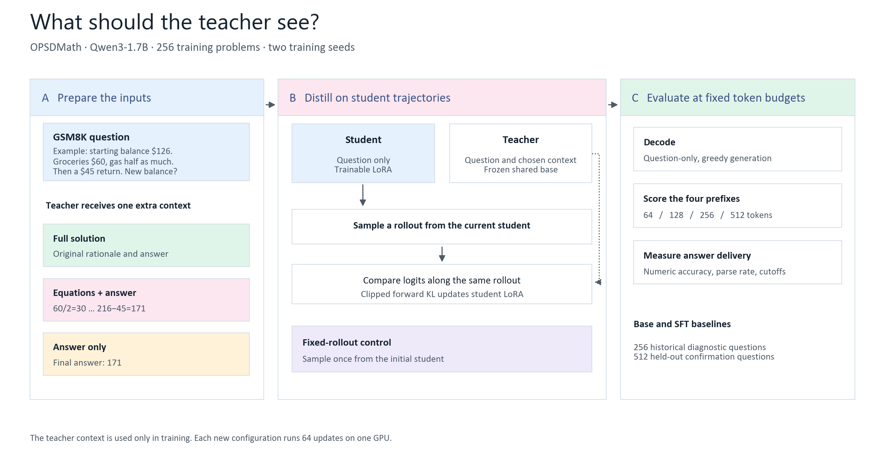

# OPSDMath 教师上下文与生成预算实验

## 设计与数据

保留 Qwen3-1.7B、GSM8K 256 道训练题、64 次更新及种子 17 和 29。此前的 256 道测试题用于历史诊断，从 GSM8K 官方测试文件中排除训练源及历史测试 ID，再按固定哈希排序取接下来的 512 道题用于确认。记录文件有独立的推理输入、参考标签和 SHA-256。四套既有 SFT 和 OPSD adapter 复用。

教师上下文比较完整参考解、算式链加最终答案、仅最终答案。学生输入保持一致。256 道训练题中 254 道可抽取算式，另外 2 道的算式链组按预先规则用相同的最终答案。固定轨迹组保存初始学生的后缀 token ID，并用相同训练题顺序和固定教师训练。

三种教师提示平均长度依次为 252.08、161.16、129.08 tokens（包含问题及模板）。人工核查了 11 道最后一条标记算式与最终数值不同的题，原因包括未标记的最后一步、单位换算或题目要求报告另一中间量。核查还发现一处原参考解文字数字与随后算式不一致。实验保留原始参考解、原算式与金标准答案。

评估在贪心生成的 64、128、256、512 token 预算下进行。主要比较为 128 tokens 下两种简化教师的宽松数值正确率差。原评分器和严格格式评分器用作敏感性分析。报告全样本正确率、可解析率、触顶率及配对区间，以防格式差异被误读为数值推理收益。

实验配置、代码和旧结果见 [训练器](run_math.py)、[预算评估](budget_study.py)、[运行入口](run_budget_experiment.py) 和 [原实验报告](实验报告.md)。[原论文](https://proceedings.mlr.press/v306/zhao26be.html)

## 旧权重预算诊断

同一张 RTX 6000D 对五套旧权重按相同的 16 道批量贪心推理。16 道开发题的直接生成和长序列前缀，在 64、128、256 三档逐 token 一致。下表为历史 256 题在 RTX 6000D 上新生成后的宽松数值评分，每个格子均为正确题数。

| 权重 | 64 | 128 | 256 | 512 |
|---|---:|---:|---:|---:|
| Base | 8 | 78 | 144 | 161 |
| SFT 17 | 3 | 69 | 176 | 196 |
| OPSD 17 | 15 | 114 | 170 | 183 |
| SFT 29 | 2 | 62 | 163 | 182 |
| OPSD 29 | 13 | 106 | 172 | 187 |

128 tokens 下，OPSD 相对 SFT 分别提升 17.58 个百分点［11.33，24.22］与 17.19 个百分点［11.72，23.05］。对应的可解析题数分别从 80 增至 149、从 76 增至 128。只在两个模型都可解析的题上比较，差值为 −1.43 和 +2.99 个百分点，但这是由输出决定的子集。原有解析器下的全样本差值同样为正，最严格行格式评分下却分别为 −14.45 和 −14.06 个百分点。512 tokens 下的两种子差值为 −5.08 和 +1.95 个百分点，两个区间均覆盖零。

结果支持“在有限预算内更常交付可以读取的数值答案”，效应大小依赖评分规则。512-token 两个种子分别生成 142.24、151.67 个 tokens，相同配置的 SFT 分别为 184.92、185.73。原 A800 256-token 生成与本次 RTX 6000D 上的逐题输出存在差异，硬件及软件栈跨次变化使两轮的 256-token 结果应各自报告。本轮各组内和组间统一使用同一张卡、分组方式与解析器。

[逐组指标](results/budget-study/diagnostic-metrics.csv)、[配对区间](results/budget-study/diagnostic-comparisons.csv) 和 [预算曲线](results/budget-study/diagnostic-budget-curves.png) 来自同一批原始生成 token。包含 token、配置和耗时的本地归档 SHA-256 与云端一致。

## 新增训练组

RTX 6000D 已完成六组训练，每组 256 条轨迹、64 次更新。同种子三组的训练题 ID 和顺序严格一致。两个固定轨迹组的缓存 ID 也同训练顺序逐项一致。

| 方法 | 种子 | 教师输入 tokens | 学生轨迹 tokens | 总耗时 |
|---|---:|---:|---:|---:|
| 算式链 | 17 | 41,256 | 36,616 | 533 s |
| 仅答案 | 17 | 33,045 | 31,127 | 497 s |
| 初始固定轨迹 | 17 | 64,532 | 36,740 | 483 s |
| 算式链 | 29 | 41,256 | 34,411 | 506 s |
| 仅答案 | 29 | 33,045 | 31,975 | 453 s |
| 初始固定轨迹 | 29 | 64,532 | 36,476 | 529 s |

六组总墙钟训练耗时约 50.0 分钟，固定组总耗时已包括预生成轨迹。该总数不含环境准备、探针与推理。单组峰值 PyTorch 分配约 5.22 GiB。六个适配器、逐步日志、固定轨迹缓存及哈希均回传本地。[逐组训练统计](results/budget-study/training.csv)

## 512 题确认集与答案交付诊断

两组待评权重在原 RTX 6000D 上用同一底模、提示、批大小 16 和 512-token 贪心解码完成评估。生成上限不写进提示。四档预算仍以同一 token 序列截取，并用三个冻结评分器重算。训练题、既有历史测试题与本确认集均按标准化题目 ID 去重。

| 算式链与仅答案，128 tokens | 算式链正确 | 仅答案正确 | 仅答案减算式链 | 题目配对 95% 区间 | 共同可解析题上的净正确数差 |
|---|---:|---:|---:|---:|---:|
| 种子 17 | 189/512 | 263/512 | +14.45 pp | +10.94 到 +18.16 pp | 0/226 |
| 种子 29 | 213/512 | 258/512 | +8.79 pp | +5.27 到 +12.30 pp | −2/248 |

主要比较预先指定为 128 tokens 的宽松数值正确率。两次结果方向一致，且绝大部分净增来自一组能提取答案、另一组没有提取到的题。共同可解析组由输出决定，仅用于分解总差。512 tokens 时，种子 29 的算式链组达到 387/512，仅答案组为 367/512。两个设置也同时改变教师文本长度和内容。 预先指定的算式数分层中，三至四条标记这一层共有 251 题，两个种子的仅答案组分别多答对 44 和 27 题，贡献了最多的净增。算式标记数只作为参考解复杂度的代理。

按冻结评分器区分三种可观察差异。预算后才可提取的例子是题目 `2f1f4cd7aa03`，种子 29 算式链在 128 tokens 结束于按周成本乘以 52 的计算，512-token 版本才给出 520。同行的仅答案组在 128 tokens 内给出 `Final answer: <520>`，宽松数值评分读取为正确，严格行格式不读取尖括号中的数值。题目 `302b2da3d35a` 的算式链输出在 128 tokens 内已完成并给出 0，遗漏了带去聚会的 48 个布朗尼，属于数值答案已交付但答错。两档均无法提取答案的样本单列为未判定。

[答案交付诊断入口](short_sft_baseline.py)

### 固定轨迹对照

128 tokens 下，在线完整参考解组相比初始固定轨迹组分别答对 226 对 198 题（种子 17，+5.47 pp，题目配对 95% 区间 +3.13 到 +8.01 pp）和 206 对 188 题（种子 29，+3.52 pp，+1.56 到 +5.66 pp）。两边都能解析的题对净正确数差分别贡献 0 和 −2 道。512 tokens 时，两种子的差值为 0 和 −1.37 pp，两个区间均跨零。这是完整参考解条件下改变学生轨迹来源的对照。

### 直接答案与算式链 SFT

为检查有限生成预算下的收益是否来自比较基线的输出习惯，本轮追加两种 SFT 监督目标。直接答案组只监督标准答案行。算式链组保留 GSM8K 原解中按顺序标记的算式及标准答案行，256 道训练题中有两道没有标记算式，沿用直接答案。两组使用原 256 道训练题、种子 17 和 29、相同 LoRA 和每种子 64 次更新。评估沿用同一提示、512-token 贪心解码及三个解析器。这是已查看确认集前序结果后的追加诊断。

直接答案 SFT 在 128 tokens 下平均使用 7.62、7.79 个输出 tokens，各有 510/512 题能解析。但数值只答对 55/512、57/512。只训练答案行能显著缩短输出，模型在此设置下很少算对，因此再用保留中间算式的 SFT 检查这一比较。

| 方法 | 128 tokens 种子 17 / 29 | 512 tokens 种子 17 / 29 |
|---|---:|---:|
| 完整解 SFT | 138/512 · 129/512 | 395/512 · 385/512 |
| 直接答案 SFT | 55/512 · 57/512 | 55/512 · 58/512 |
| 算式链 SFT | 195/512 · 195/512 | 257/512 · 256/512 |
| 完整参考解 OPSD | 226/512 · 206/512 | 369/512 · 381/512 |
| 仅答案教师 OPSD | 263/512 · 258/512 | 366/512 · 367/512 |

表中为宽松数值评分。128 tokens 下，仅答案教师 OPSD 相对算式链 SFT 提升 +13.28 和 +12.30 个百分点，题目配对区间分别为 +8.59 到 +17.97 和 +7.62 到 +16.99 个百分点。完整参考解 OPSD 提升 +6.05 和 +2.15 个百分点，种子 29 的区间 −2.54 到 +6.84 包含零。

算式链 SFT 可提取答案的题更多（384、389 对 332、324），平均输出也更短（73.78、69.02 对 101.64、102.52 tokens）。在双方都能解析的题中，仅答案教师 OPSD 两个种子各净多答对 73 题，说明本对比的净优势不能由解析覆盖率解释。该子集由模型输出决定，无法用来估计普遍推理能力。严格答案行评分下，算式链 SFT 得到 162/512、156/512，仅答案教师 OPSD 得到 0/512、3/512。这反映了标准化答案行的输出差异。

现有证据支持一个具体取舍。在 128-token 上限、允许提取常见格式中的最终数值时，仅答案教师 OPSD 比两种简短目标的 SFT 答对更多题。对于严格接口或更长预算，选用哪种训练方式要看对应的评分和预算。四套新增 SFT 已核对训练 ID 顺序、每组 64 次更新、权重哈希及全部答案记录。15 组、4 档预算、3 种解析器共 180 行指标均从保存的输出复算。

[确认集指标](results/budget-study/confirmation-metrics.csv) · [配对区间](results/budget-study/confirmation-comparisons.csv) · [逐题差异分解](results/budget-study/answer-delivery-paired.csv) · [预算曲线](results/budget-study/confirmation-budget-curves.png)

### SVAMP 跨题源抽样

从 SVAMP 发布数据中按固定源码版本和 SHA-256 排序抽取 256 道算术文字题，并排除与 GSM8K 训练题规范化文本重合的样本。评估复用原有权重和学生提示，直接以 128 tokens 为生成上限。预先锁定的跨题源对照是仅答案教师 OPSD 与算式链 SFT，涉及两个训练种子。

| 种子 | 仅答案教师 OPSD | 算式链 SFT | 数值差值 | 题目配对 95% 区间 |
|---|---:|---:|---:|---:|
| 17 | 212/256 | 138/256 | +28.91 pp | +22.27 到 +35.55 pp |
| 29 | 206/256 | 131/256 | +29.30 pp | +23.05 到 +35.55 pp |

严格答案行评分仍更有利于算式链 SFT（126、116 道，对比 OPSD 的 2、11 道）。短预算下可提取正确数值的增益在第二题源保留；结论范围为固定模型和这两种训练方法，下载的数据用于抽样评估。

[SVAMP 原论文](https://aclanthology.org/2021.naacl-main.168/) · [抽样脚本](prepare_svamp.py) · [数据清单](results/budget-study/svamp-manifest.json) · [指标](results/budget-study/svamp-metrics.csv) · [配对区间](results/budget-study/svamp-comparisons.csv)

### 共用的结构化答案字段

为验证优势能否保留在统一输出接口下，用相同适配权重和输入提示追加一项回顾性复测。每个问题用原模型生成最多 104 个草稿 tokens，然后附加计入预算的标准答案行标记。相同的数字文法约束两个模型的答案字段，数字、符号和结束标记都计入 128-token 总上限。模型必须给出可解析数值并结束字段，提前截断或无效字段按错计。这个解码会改变模型的提交行为，适合回答统一接口下的表现。

| 数据和种子 | 仅答案教师 OPSD | 算式链 SFT | 数值差值 | 题目配对 95% 区间 |
|---|---:|---:|---:|---:|
| GSM8K 17 | 259/512 | 196/512 | +12.30 pp | +7.42 到 +16.99 pp |
| GSM8K 29 | 248/512 | 198/512 | +9.77 pp | +4.88 到 +14.45 pp |
| SVAMP 17 | 207/256 | 144/256 | +24.61 pp | +17.97 到 +31.25 pp |
| SVAMP 29 | 202/256 | 138/256 | +25.00 pp | +18.36 到 +31.64 pp |

GSM8K 中 OPSD 成功结束数值字段的题分别为 477、469，算式链 SFT 为 505、506。两者返回的有效答案使用同一种输出格式。数值正确率的差距在控制输出文法后保留，OPSD 仍有更高的字段未完成比例和生成长度。本实验复用已读的 GSM8K 与 SVAMP 样本，区间为按题目配对的区间。它有助于排除这一个评估协议里的格式混淆，未隔离教师提示的内容与长度。

[结构化解码代码](structured_answer_budget.py) · [评分器](score_structured_answer.py) · [GSM8K 指标](results/budget-study/structured-gsm8k-metrics.csv) · [SVAMP 指标](results/budget-study/structured-svamp-metrics.csv)
